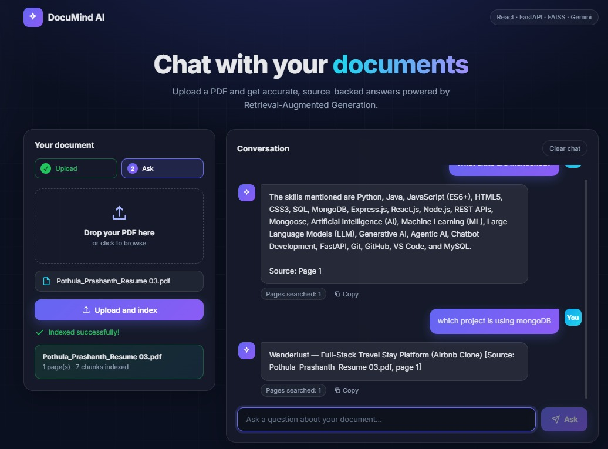

# DocuMind AI: RAG Document Chatbot



Upload a PDF and ask questions about it. The app finds the most relevant parts of the document and uses an LLM to write an answer from them only. If the answer is not in the document, it says so instead of making something up.


## How it works

1. **Ingest:** the PDF is read page by page and split into small overlapping chunks.
2. **Embed:** each chunk is converted into a vector with `sentence-transformers` (`all-MiniLM-L6-v2`).
3. **Index:** the vectors are stored in a FAISS index for fast similarity search.
4. **Retrieve:** the question is embedded and the 5 closest chunks are found.
5. **Generate:** the question and the chunks go to Gemini, with rules to answer only from the context.

## Tech stack

| Layer | Tools |
|---|---|
| Frontend | React, Vite, plain CSS |
| Backend | Python, FastAPI, Uvicorn |
| Retrieval | sentence-transformers, FAISS, pypdf |
| LLM | Google Gemini API |

## Features

- Drag and drop PDF upload
- Answers grounded in the document, with "not found" handling
- Page references for each answer
- Suggested questions, copy button, typing indicator
- Responsive, animated interface

## Project structure

```
rag-doc-chatbot/
├── app/                 # FastAPI backend
│   ├── loader.py        # PDF text extraction
│   ├── chunker.py       # overlapping text chunks
│   ├── vectorstore.py   # embeddings + FAISS index
│   ├── rag.py           # retrieval + Gemini answer
│   └── main.py          # API endpoints
├── frontend/            # React app
├── data/                # uploaded PDFs (ignored by Git)
├── requirements.txt
└── .env.example
```

## Run it locally

### 1. Backend

```bash
git clone https://github.com/YOUR_USERNAME/rag-doc-chatbot.git
cd rag-doc-chatbot
python -m venv venv
venv\Scripts\activate          # Windows
# source venv/bin/activate     # Mac/Linux
pip install -r requirements.txt
```

Create a `.env` file (copy `.env.example`) and add your free key from https://aistudio.google.com/apikey:

```
GEMINI_API_KEY=your_key_here
GEMINI_MODEL=gemini-3.5-flash-lite
```

Start the server:

```bash
uvicorn app.main:app --reload
```

API docs: http://127.0.0.1:8000/docs

### 2. Frontend

```bash
cd frontend
npm install
npm run dev
```

Open http://localhost:5173

## API endpoints

| Method | Endpoint | Description |
|---|---|---|
| GET | `/` | Health check |
| POST | `/upload` | Upload a PDF, then chunk, embed and index it |
| POST | `/ask` | Body: `{"question": "...", "k": 5}`. Returns the answer and sources |

## Limitations and next steps

- One document at a time: a new upload replaces the previous index
- Scanned PDFs are not supported (OCR would be needed)
- Planned: multiple documents, streaming answers, deployment

## Author

Pothula Prashanth: [GitHub](https://github.com/prashanth-THE-developer)
